# ERD — PeopleOps Data Model
 
Version 1.0 · Created 2026-09-14 · Database: PostgreSQL (`peopleops_db`)
 
This is the **final design**. The build follows the weekly plan:
 
- **Week 1:** every entity is created with its fields. Foreign keys are **plain `Long` columns** (for example `departmentId`). No relationship annotations yet.
- **Week 4:** each plain `Long` field is replaced by a JPA relationship that uses the **same column name** (`department_id`), so the table does not change shape.
---
 
## 1. Diagram
 
`FK` marks a foreign key. Until Week 4 it is a plain column; from Week 4 it is a real database foreign key. `Candidate → Employee` (`candidateId`) is added in Week 4 only.

```mermaid
erDiagram
    DEPARTMENT ||--o{ EMPLOYEE : "has"
    DESIGNATION ||--o{ EMPLOYEE : "held by"
    EMPLOYEE ||--o{ EMPLOYEE : "manages"
    DEPARTMENT ||--o{ JOB_OPENING : "hires for"
    DESIGNATION ||--o{ JOB_OPENING : "for role"
    JOB_OPENING ||--o{ CANDIDATE : "receives"
    CANDIDATE ||--o{ INTERVIEW : "attends"
    EMPLOYEE ||--o{ INTERVIEW : "conducts"
    CANDIDATE |o--o| EMPLOYEE : "becomes"
    EMPLOYEE ||--o{ ONBOARDING_TASK : "completes"
    EMPLOYEE ||--o{ ATTENDANCE : "marks"
    EMPLOYEE ||--o{ LEAVE_BALANCE : "holds"
    LEAVE_TYPE ||--o{ LEAVE_BALANCE : "defines"
    EMPLOYEE ||--o{ LEAVE_REQUEST : "requests"
    LEAVE_TYPE ||--o{ LEAVE_REQUEST : "of type"
    EMPLOYEE |o--o{ LEAVE_REQUEST : "decides"
    EMPLOYEE ||--o{ PAYROLL : "paid via"
    EMPLOYEE ||--o{ PERFORMANCE_REVIEW : "is reviewed in"
    EMPLOYEE ||--o{ PERFORMANCE_REVIEW : "reviews"
    TRAINING_PROGRAM ||--o{ TRAINING_ENROLLMENT : "has"
    EMPLOYEE ||--o{ TRAINING_ENROLLMENT : "joins"
    ASSET ||--o{ ASSET_ASSIGNMENT : "given in"
    EMPLOYEE ||--o{ ASSET_ASSIGNMENT : "receives"
    EMPLOYEE ||--o{ EMPLOYEE_DOCUMENT : "owns"
    EMPLOYEE ||--o| OFFBOARDING : "exits via"
    EMPLOYEE }o--o{ SKILL : "has"
    TRAINING_PROGRAM }o--o{ SKILL : "teaches"
 
    DEPARTMENT {
        Long id PK
        String name UK
        String code UK
        String description
        Boolean active
    }
    DESIGNATION {
        Long id PK
        String title UK
        Integer gradeLevel
        String description
    }
    EMPLOYEE {
        Long id PK
        String employeeCode UK
        String firstName
        String lastName
        String email UK
        String phone
        LocalDate dateOfBirth
        LocalDate dateOfJoining
        BigDecimal monthlySalary
        EmployeeStatus status
        Long departmentId FK
        Long designationId FK
        Long managerId FK
        Long candidateId FK
    }
    JOB_OPENING {
        Long id PK
        String title
        Long departmentId FK
        Long designationId FK
        Integer openPositions
        LocalDate postedDate
        JobOpeningStatus status
    }
    CANDIDATE {
        Long id PK
        Long jobOpeningId FK
        String firstName
        String lastName
        String email
        String phone
        String resumeNotes
        LocalDate appliedDate
        CandidateStage stage
    }
    INTERVIEW {
        Long id PK
        Long candidateId FK
        Long interviewerId FK
        LocalDateTime scheduledAt
        Integer roundNumber
        InterviewResult result
        String feedback
    }
    ONBOARDING_TASK {
        Long id PK
        Long employeeId FK
        String title
        String description
        LocalDate dueDate
        OnboardingTaskStatus status
        LocalDate completedOn
    }
    ATTENDANCE {
        Long id PK
        Long employeeId FK
        LocalDate attendanceDate
        LocalTime checkIn
        LocalTime checkOut
        AttendanceStatus status
    }
    LEAVE_TYPE {
        Long id PK
        String name UK
        Integer annualQuota
        Boolean paid
    }
    LEAVE_BALANCE {
        Long id PK
        Long employeeId FK
        Long leaveTypeId FK
        Integer balanceYear
        Integer totalDays
        Integer usedDays
    }
    LEAVE_REQUEST {
        Long id PK
        Long employeeId FK
        Long leaveTypeId FK
        LocalDate fromDate
        LocalDate toDate
        Integer days
        String reason
        LeaveRequestStatus status
        Long decidedById FK
        LocalDate decidedOn
    }
    PAYROLL {
        Long id PK
        Long employeeId FK
        Integer payMonth
        Integer payYear
        Integer workingDays
        Double lopDays
        BigDecimal grossSalary
        BigDecimal lopDeduction
        BigDecimal pfDeduction
        BigDecimal netSalary
        PayrollStatus status
        LocalDate generatedOn
    }
    PERFORMANCE_REVIEW {
        Long id PK
        Long employeeId FK
        Long reviewerId FK
        String reviewPeriod
        Integer rating
        String comments
        ReviewStatus status
        LocalDate reviewDate
    }
    SKILL {
        Long id PK
        String name UK
        String category
    }
    TRAINING_PROGRAM {
        Long id PK
        String title
        String description
        String trainerName
        LocalDate startDate
        LocalDate endDate
        TrainingStatus status
    }
    TRAINING_ENROLLMENT {
        Long id PK
        Long trainingProgramId FK
        Long employeeId FK
        EnrollmentStatus status
        LocalDate completionDate
    }
    ASSET {
        Long id PK
        String assetTag UK
        String name
        String category
        LocalDate purchaseDate
        AssetStatus status
    }
    ASSET_ASSIGNMENT {
        Long id PK
        Long assetId FK
        Long employeeId FK
        LocalDate assignedDate
        LocalDate returnedDate
        AssignmentStatus status
    }
    EMPLOYEE_DOCUMENT {
        Long id PK
        Long employeeId FK
        DocumentType documentType
        String fileName
        String fileUrl
        LocalDate uploadedOn
        Boolean verified
    }
    OFFBOARDING {
        Long id PK
        Long employeeId FK
        LocalDate resignationDate
        LocalDate lastWorkingDate
        String reason
        String exitInterviewNotes
        OffboardingStatus status
    }
```
 

 
## 2. Tables
 
Java class → table. Every `id` is `Long`, `GenerationType.IDENTITY`. Enums use `@Enumerated(EnumType.STRING)`.
 
| Entity | Table | Entity | Table |
|---|---|---|---|
| Department | `departments` | Payroll | `payrolls` |
| Designation | `designations` | PerformanceReview | `performance_reviews` |
| Employee | `employees` | Skill | `skills` |
| JobOpening | `job_openings` | TrainingProgram | `training_programs` |
| Candidate | `candidates` | TrainingEnrollment | `training_enrollments` |
| Interview | `interviews` | Asset | `assets` |
| OnboardingTask | `onboarding_tasks` | AssetAssignment | `asset_assignments` |
| Attendance | `attendance_records` | EmployeeDocument | `employee_documents` |
| LeaveType | `leave_types` | Offboarding | `offboardings` |
| LeaveBalance | `leave_balances` | | |
| LeaveRequest | `leave_requests` | **Total: 20 tables** (+2 join tables in Week 4) | |
 
Names avoid SQL words (`attendanceDate`, `payMonth`, `payYear`, `balanceYear`) so PostgreSQL never needs quoting.
 
## 3. Column rules
 
- Strings: length 255 by default; names/titles 100; `email` 150; `phone` 20; free text (`description`, `reason`, `comments`, `feedback`, `resumeNotes`, `exitInterviewNotes`) 1000.
- Money (`monthlySalary`, `grossSalary`, `lopDeduction`, `pfDeduction`, `netSalary`): `BigDecimal`, precision 12, scale 2.
- `Employee.candidateId` does **not** exist in Week 1; it arrives with the Candidate↔Employee mapping in Phase 4.6.
- Nullable by design: `Employee.dateOfBirth`, `Employee.managerId`, `Employee.phone`, `LeaveRequest.decidedById/decidedOn`, `AssetAssignment.returnedDate`, `OnboardingTask.completedOn`, `TrainingEnrollment.completionDate`, `Attendance.checkIn/checkOut`.
- Everything else is `nullable = false`.
## 4. Composite unique constraints
 
Declared in `@Table(uniqueConstraints = ...)` in Week 1.
 
| Table | Unique on |
|---|---|
| `candidates` | `job_opening_id`, `email` |
| `attendance_records` | `employee_id`, `attendance_date` |
| `leave_balances` | `employee_id`, `leave_type_id`, `balance_year` |
| `payrolls` | `employee_id`, `pay_month`, `pay_year` |
| `performance_reviews` | `employee_id`, `review_period` |
| `training_enrollments` | `training_program_id`, `employee_id` |
| `offboardings` | `employee_id` |
 
Single-column uniques are marked `UK` in the diagram.
 
## 5. Enums
 
| Enum | Values |
|---|---|
| EmployeeStatus | ONBOARDING, ACTIVE, ON_NOTICE, EXITED |
| JobOpeningStatus | OPEN, CLOSED |
| CandidateStage | APPLIED, SHORTLISTED, INTERVIEWED, OFFERED, HIRED, REJECTED |
| InterviewResult | PENDING, PASSED, FAILED |
| OnboardingTaskStatus | PENDING, DONE |
| AttendanceStatus | PRESENT, HALF_DAY, ABSENT, ON_LEAVE |
| LeaveRequestStatus | PENDING, APPROVED, REJECTED, CANCELLED |
| PayrollStatus | GENERATED, PAID |
| ReviewStatus | DRAFT, SUBMITTED |
| TrainingStatus | PLANNED, ONGOING, COMPLETED, CANCELLED |
| EnrollmentStatus | ENROLLED, COMPLETED, DROPPED |
| AssetStatus | AVAILABLE, ASSIGNED, RETIRED |
| AssignmentStatus | ASSIGNED, RETURNED |
| DocumentType | ID_PROOF, ADDRESS_PROOF, OFFER_LETTER, CONTRACT, EDUCATION_CERTIFICATE, OTHER |
| OffboardingStatus | INITIATED, COMPLETED |
 
Stored as text so the database stays readable. Total: 15 enums.
 
## 6. Week 4 relationship plan
 
Each row replaces a plain `Long` field (or adds a join table). DTOs keep exposing IDs; only the entity changes.
 
| # | Relationship | Type | Owning side | Column / table | Step |
|---|---|---|---|---|---|
| R1 | Department → Employee | 1-N / N-1 | `Employee.department`; `Department.employees` (`mappedBy`) | `employees.department_id` | 4.1.1, 4.1.4 |
| R2 | Designation → Employee | N-1 | `Employee.designation` | `employees.designation_id` | 4.1.2 |
| R3 | Employee → Employee (manager) | N-1 (self) | `Employee.manager` | `employees.manager_id` | 4.1.3 |
| R4 | Department, Designation → JobOpening | N-1 | `JobOpening.department`, `.designation` | `job_openings.*_id` | 4.2.1 |
| R5 | JobOpening → Candidate | 1-N / N-1 | `Candidate.jobOpening`; `JobOpening.candidates` (`mappedBy`) | `candidates.job_opening_id` | 4.2.2 |
| R6 | Candidate, Employee → Interview | N-1 | `Interview.candidate`, `.interviewer` | `interviews.candidate_id`, `interviewer_id` | 4.2.3 |
| R7 | Employee → OnboardingTask | 1-N / N-1 | `OnboardingTask.employee`; `Employee.onboardingTasks` (cascade ALL, orphanRemoval) | `onboarding_tasks.employee_id` | 4.2.4 |
| R8 | Employee → Attendance | N-1 | `Attendance.employee` | `attendance_records.employee_id` | 4.3.1 |
| R9 | Employee, LeaveType → LeaveBalance | N-1 | `LeaveBalance.employee`, `.leaveType` | `leave_balances.*_id` | 4.3.2 |
| R10 | Employee, LeaveType, decider → LeaveRequest | N-1 | `LeaveRequest.employee`, `.leaveType`, `.decidedBy` | `leave_requests.*_id` | 4.3.3 |
| R11 | Employee → Payroll | N-1 | `Payroll.employee` | `payrolls.employee_id` | 4.4.1 |
| R12 | Employee, reviewer → PerformanceReview | N-1 | `PerformanceReview.employee`, `.reviewer` | `performance_reviews.*_id` | 4.4.2 |
| R13 | TrainingProgram, Employee → TrainingEnrollment | N-1 | `TrainingEnrollment.trainingProgram`, `.employee` | `training_enrollments.*_id` | 4.5.1 |
| R14 | Asset, Employee → AssetAssignment | N-1 | `AssetAssignment.asset`, `.employee` | `asset_assignments.*_id` | 4.5.2 |
| R15 | Employee → EmployeeDocument | N-1 | `EmployeeDocument.employee` | `employee_documents.employee_id` | 4.5.3 |
| R16 | Employee ↔ Offboarding | **1-1** | `Offboarding.employee` (unique) | `offboardings.employee_id` | 4.6.1 |
| R17 | Candidate ↔ Employee | **1-1** | `Employee.candidate` (nullable, unique) | `employees.candidate_id` | 4.6.2 |
| R18 | Employee ↔ Skill | **N-N** | `Employee.skills` with `@JoinTable` | `employee_skills(employee_id, skill_id)` | 4.7.1 |
| R19 | TrainingProgram ↔ Skill | **N-N** | `TrainingProgram.skills` with `@JoinTable` | `training_program_skills(training_program_id, skill_id)` | 4.7.2 |
 
Mapping rules:
- Every `@ManyToOne` and `@ManyToMany` uses `FetchType.LAZY`.
- Only R7 cascades. All other relationships have no cascade.
- Only R1, R5 and R7 are bidirectional; the rest are one-directional from the "many" side.
- Foreign key column names stay identical to the Week 1 field names in snake_case.
- Repository finders such as `findByEmployeeId` keep working after the change because Spring Data reads `employee.id`.
## 7. Lifecycle data flow
 
| Event | Writes to |
|---|---|
| Hire candidate | `candidates` (stage), `job_openings` (positions), `employees` (new), `onboarding_tasks` (5 new) |
| Activate employee | `employees` (status), `leave_balances` (one per leave type) |
| Approve leave | `leave_requests`, `leave_balances`, `attendance_records` (ON_LEAVE rows) |
| Generate payroll | `payrolls` (reads `attendance_records`, `leave_requests`, `employees`) |
| Assign / return asset | `asset_assignments`, `assets` |
| Complete training (W4) | `training_enrollments`, `employee_skills` |
| Start offboarding | `offboardings`, `employees` (ON_NOTICE) |
| Complete offboarding | `offboardings`, `employees` (EXITED) |
 