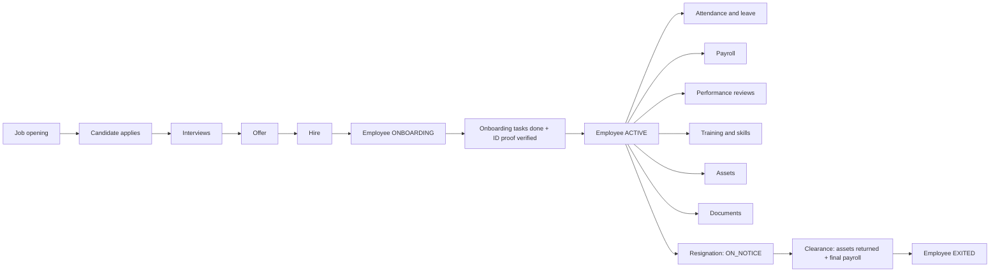

# PRD — PeopleOps: Employee Lifecycle & Workforce Management System

Version 1.0 · Created 2026-10-02 · Owner: Shabdansh Prajapati

---

## 1. Purpose

PeopleOps is an HRMS built around the **employee lifecycle** (recruit → hire → onboard → work → exit), not a set of separate CRUD screens. Every module either moves an employee to the next lifecycle stage or reacts to the stage the employee is in.

This semester (Semester 1) delivers the **backend** as a Spring Boot REST API, following the 4-week FSD PBL notice.

## 2. Goals and non-goals

**Goals**
- A working backend covering 13 areas: employees, departments, designations, recruitment, onboarding, attendance, leave, payroll, performance, training/skills, assets, documents, offboarding.
- Modules that interact through the employee lifecycle (hire creates an employee, onboarding activates them, offboarding checks assets and payroll).
- Clean, readable, student-level Java/Spring Boot code the author can fully explain.
- Delivery as an executable JAR with Swagger/OpenAPI documentation.

**Non-goals (this semester)**
- No frontend (Semester 2). No authentication, login or roles (Semester 3).
- No real file upload (documents store metadata and a file URL/name only).
- No email/SMS, no scheduling jobs, no multi-company support, no real tax/statutory payroll.

## 3. Users (conceptual)

| User | What they do | Note |
|---|---|---|
| HR admin | Manages everything: openings, hiring, payroll, documents, offboarding | All endpoints open in Semester 1 |
| Manager | Approves leave, reviews team members, interviews | Passed as an ID (`decidedById`, `reviewerId`) in Semester 1 |
| Employee | Marks attendance, requests leave, enrols in training | Passed as `employeeId` in Semester 1 |

Roles are only enforced in Semester 3 (RBAC). Until then, "who did this" is an ID in the request.

## 4. Lifecycle overview

**Employee status:** `ONBOARDING → ACTIVE → ON_NOTICE → EXITED`. "Working" means `ACTIVE` or `ON_NOTICE`.

## 5. Modules

| # | Module | What it does | Lifecycle link |
|---|---|---|---|
| 1 | Department | Company departments | Employees and openings belong to one |
| 2 | Designation | Job titles and grade level | Changed on promotion |
| 3 | Employee | Core employee record, manager, status | Centre of every other module |
| 4 | Recruitment | Job openings, candidates, interviews | A hired candidate becomes an employee |
| 5 | Onboarding | Joining checklist per employee | Completing it activates the employee |
| 6 | Attendance | Daily check-in/out | Feeds payroll loss-of-pay |
| 7 | Leave | Leave types, balances, requests, approval | Approval updates balance and attendance; unpaid leave feeds payroll |
| 8 | Payroll | Monthly salary calculation | Uses attendance and leave; final payroll needed to exit |
| 9 | Performance | Periodic reviews by a reviewer | Reviewer must be another working employee |
| 10 | Training & Skills | Programs, enrolments, skills | Completing a program adds skills (Week 4) |
| 11 | Assets | Company assets and assignments | Must be returned before exit |
| 12 | Documents | Employee document metadata, verification | Verified ID proof is required to activate |
| 13 | Offboarding | Resignation to exit workflow | Moves status to ON_NOTICE, then EXITED |

## 6. Business rules

Rule IDs are used in code comments, TRD and explainer.

| ID | Rule |
|---|---|
| BR-01 | **Hire.** A candidate can be hired only if stage is `OFFERED` and the opening is `OPEN`. Hiring sets the candidate to `HIRED`, creates an employee (`ONBOARDING`, code `EMP-0001` style, email and name from the candidate), reduces the opening's open positions by 1, and closes the opening when it reaches 0. |
| BR-02 | **Onboarding checklist.** Creating an employee (by hire or directly) auto-generates 5 default onboarding tasks: identity documents, sign offer/contract, collect work asset, HR orientation, set up work email. Due date = joining date + 7 days. |
| BR-03 | **Activation.** When all onboarding tasks are `DONE` and the employee has at least one verified `ID_PROOF` document, the employee becomes `ACTIVE` and one leave balance per leave type is created (total = annual quota, current year). |
| BR-04 | **Attendance.** Only working employees. One record per employee per date, not in the future. `PRESENT`/`HALF_DAY` need a check-in. Check-out must be after check-in; under 4 hours becomes `HALF_DAY`. |
| BR-05 | **Leave request.** Working employee; `fromDate ≤ toDate`, same calendar year; days = calendar days inclusive; no overlap with the employee's own `PENDING`/`APPROVED` requests; a paid leave type needs enough balance. |
| BR-06 | **Leave decision.** Only `PENDING` requests. The decider is a working employee other than the requester. Approve: paid leave deducts the balance and creates `ON_LEAVE` attendance for each date without a record. Reject and cancel only change status; cancel is allowed only while `PENDING`. |
| BR-07 | **Payroll.** One per employee per month. Working days = Mon–Fri of the month. LOP days = absent days + 0.5 × half days + approved unpaid leave days in the month. Deduction = gross ÷ working days × LOP days. PF = 12% of gross. Net = gross − LOP deduction − PF. Status `GENERATED → PAID`; only `GENERATED` can be deleted. |
| BR-08 | **Performance review.** Reviewer is a working employee other than the reviewed employee. One review per employee per period. Rating 1–5. A `SUBMITTED` review cannot be edited or deleted. |
| BR-09 | **Training.** Enrol only working employees into `PLANNED`/`ONGOING` programs, no duplicates. Only an `ENROLLED` enrolment can be completed or dropped. From Week 4, completing adds the program's skills to the employee. |
| BR-10 | **Assets.** Only an `AVAILABLE` asset can be assigned, and only to an `ONBOARDING` or `ACTIVE` employee. Assign sets the asset `ASSIGNED`; return sets the assignment `RETURNED` and the asset `AVAILABLE`. Only `AVAILABLE` assets can be retired. |
| BR-11 | **Documents.** A document is created unverified. Verifying it can trigger activation (BR-03). |
| BR-12 | **Offboarding.** Start only for an `ACTIVE` employee; last working date ≥ resignation date; employee becomes `ON_NOTICE`; one offboarding per employee. Complete only if no asset is still `ASSIGNED` and a payroll exists for the last working date's month; then employee becomes `EXITED`. Deleting an `INITIATED` offboarding returns the employee to `ACTIVE`. |
| BR-13 | **Deletes.** A department or designation cannot be deleted while employees use it. An employee can be deleted only while `ONBOARDING` (their onboarding tasks go with them). Other parent/child protection comes from foreign keys in Week 4. |
| BR-14 | **References.** Every ID in a request must exist. A manager must exist and cannot be the employee themselves. Emails and employee codes are unique. |

## 7. Semester roadmap

| Semester | Scope |
|---|---|
| 1 (now) | Backend, 4 weeks per the FSD notice |
| 2 | Frontend consuming this API (adds CORS) |
| 3 | Authentication and RBAC (HR admin / Manager / Employee) |

Design choices in Semester 1 keep Semester 3 easy: "who did this" is already an ID in requests, and controllers stay thin so security can wrap them later.

## 8. Weekly deliverables and acceptance

| Week | Deliverable | Accepted when |
|---|---|---|
| 1 | Requirements, ERD, PostgreSQL DB, project setup, connectivity, entities | `peopleops_db` exists, app connects, 20 tables are created, fields match ERD.md |
| 2 | REST APIs with GET/POST/PUT/DELETE/PATCH | Every endpoint in TRD §6 works in Postman; hire → onboard → work → exit runs end to end using IDs only |
| 3 | Logging, exception handling, validation, Swagger, API testing | Log file written, errors return one JSON shape, invalid input rejected, Swagger UI lists all controllers |
| 4 | Mappings, mapping tests, JAR, final testing | All ERD relationships mapped with real foreign keys, full lifecycle passes, `java -jar` runs the app |

## 9. Non-functional requirements

- Readable code a student can explain; no needless abstraction.
- PostgreSQL as the only database. REST over JSON.
- Executable JAR built by Maven.
- Every change recorded in `explainer.md`; repository updated in the order of the weekly plan.

## 10. Assumptions

- Single company, single currency (INR), amounts stored as `BigDecimal`.
- Leave year = calendar year. Weekends = Saturday and Sunday. No public holiday calendar.
- Payroll is a simplified calculation, not statutory.
- The complexity benchmark in `complexity-benchmark.md` may adjust scope; any change is logged in `explainer.md`.